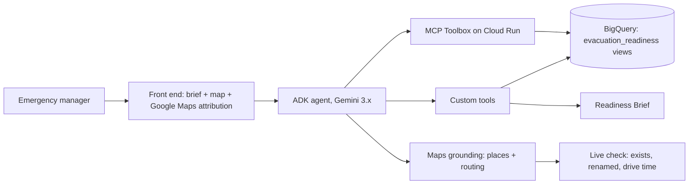

# Team 9 Plan: Florida Evacuation Readiness Agent

_Draft, 2026-10-20. Edit freely._

## The plan

**Our agent helps the Lee County, FL emergency manager decide where to stage pickup points for car-less, older and disabled residents, and which shelters to verify, before September 1.**

The agent does four things:

- Ranks the census tracts whose residents cannot evacuate on their own.
- Matches those tracts to nearby shelters that are open before landfall (`usage` = EVAC) and outside the surge zone.
- Verifies each shelter live on Google Maps: does it exist, has it been renamed, what is the drive time.
- Writes a four-part Readiness Brief.

"Unrecorded" is never treated as "No". Lee County is a proposal; the county is a one-line change (`county_fips = '12071'`).

Why Lee County: Hurricane Ian made landfall there in 2022, and much of the coast (Fort Myers Beach, Cape Coral, Sanibel) is surge zone. That makes the "is the shelter itself in the surge zone?" question real, not hypothetical.

## Why Florida

- **Missing records:** 88% of shelters (2,463 of 2,793) have no wheelchair record, so our honesty story is strongest here.
- **Distance:** for the median tract, the nearest shelter is under 2 km away, but the nearest shelter *anyone recorded* as wheelchair-accessible is just over 7 km away. This number measures paperwork as much as buildings, and we say so.
- **Isolation:** 493,461 people live more than 10 km from any shelter.
- **Medical needs:** 155 medical-needs shelters keep a medical stretch goal possible.
- **Low setup risk:** Florida is the default state in the notebook.

Caveat: Florida has no `pct_lacktrpt` column, so we quote vehicle ownership (`pct_no_vehicle`) and say so. Owning no car is not the same as having no ride.

These are statewide figures. The data lane replaces them with Lee County figures by 0:45 (see D3 in the data plan).

## Our track

- **Lead:** Getting people out.
- **Support:** Shelter readiness, to verify where people would go.
- **Stretch:** Medically dependent.

One deep track beats three shallow ones, and in this track every Maps call changes an answer.

## Our differentiators

1. **Unrecorded is not No.** The agent says "3 shelters I can speak to, 14 nobody has assessed."
2. **Maps grounding one building at a time, and acted on.** A failed check drops, flags or re-ranks a shelter.
3. **Real drive times** via Maps `routing`, not straight-line distance.
4. **Every fact is labelled** "FEMA record" or "checked on Google Maps today".
5. **"Reachable" is stricter for car-less tracts.**
6. **An equity audit** of our own ranking.

Stretch: an assessment agent that collects the missing wheelchair records from shelter operators.

## Data plan

The data lane owns everything between the raw tables and the queries the agent's tools call. Each step below says what we do and why.

### What we use

| Table | Columns we use | Answers |
| --- | --- | --- |
| `vulnerability_tracts` | `geo_id`, `lat`, `lon`, `county_fips`, `households_no_vehicle`, `pct_no_vehicle`, `pct_age_65_plus`, `pct_disability`, `mobile_homes`, `pct_mobile_homes` | Who cannot leave |
| `shelters` | `shelter_id`, `shelter_name`, address fields, `latitude`, `longitude`, `county_fips`, `evacuation_capacity`, `usage`, `wheelchair_accessible`, `generator_onsite`, `in_surge_slosh_area`, `is_medical` | Where they would go |
| `hazard_tracts` | hurricane (`HRCN_*`) and coastal-flood (`CFLD_*`) exposure | How exposed the ground is |
| `power_dependent_counties` | Lee County row only | How many depend on electricity (county-level, never per block) |
| `care_facilities` | Lee County nursing homes, `certified_beds` | Stretch: medically dependent |

Column names come from the notebook. Check them against the loaded tables before writing SQL.

### D1. Load and read the warnings (0:00–0:20)

- One person runs `notebooks/c4_01_load_explore.ipynb` with `STATE = "FL"`. If it fails, run `bash scripts/load.sh FL`.
- Read every WARN row in section 12 and write down what each one is. At least one goes on a slide.
- **Why:** the README scores validation under "Rigor & judgment". "We checked, and here is what we found" earns points; "no error" does not.

### D2. Rules every query follows

- `wheelchair_accessible`, `generator_onsite` and `in_surge_slosh_area` are true/false with NULL meaning **unrecorded**. Never write `COALESCE(x, FALSE)` and never filter with `WHERE x` alone, because that silently drops the unrecorded rows. Always count TRUE, FALSE and NULL separately.
- Ignore `ada_compliant`. It looks like the right field but has 63 YES rows nationwide; `wheelchair_accessible` is the real one.
- Never drop or overwrite a FEMA row. If a value looks impossible, flag it and print it.
- **Why:** if unrecorded collapses into "no" anywhere in the data, the agent will repeat it as fact ("no accessible shelters nearby"), which is the worst answer this challenge can produce.

### D3. Scope to Lee County and pull the headline numbers (by 0:45)

Filter on `county_fips = '12071'` (tracts can also be matched by `geo_id` starting with `12071`). Hand the story lane:

- number of tracts and shelters in the county
- wheelchair YES / NO / unrecorded counts for the county's shelters
- how many shelters are EVAC vs POST, and how many are in the surge zone (TRUE / FALSE / unrecorded)
- Lee County's power-dependent residents (emPOWER)
- households with no vehicle, county total

**Why:** the brief is for one county. Statewide numbers in a county brief look like we did not do the county.

### D4. Put shelters on tracts

Shelters have a county but no tract id. We assign each shelter to the **nearest tract centroid** in `vulnerability_tracts` using `ST_DISTANCE`.

**Why:** the alternative, a spatial join against the BigQuery tract outlines, uses 2010 boundaries, and about a third of 2020 tract ids will not match. Nearest centroid is approximate but loses nothing. We say in the deck that we did this.

### D5. Which shelters count as a destination

For pickup before landfall, a shelter counts only if:

- `usage` is EVAC (check the distinct values first in case some rows mean both), **and**
- it is not recorded as in the surge zone.

Surge zone handling: `in_surge_slosh_area = TRUE` is excluded and goes on the "fix before the season" list. NULL is kept but labelled "surge status unrecorded".

**Why:** POST shelters open after impact, so sending people there before a storm is wrong. A shelter in the surge zone in Lee County is a gap the manager needs to know about, not a destination.

### D6. The stranded score

Per tract, take the percentile rank within Lee County of each of:

- `pct_no_vehicle`
- `pct_age_65_plus`
- `pct_disability`
- `pct_mobile_homes`

The stranded score is the average of the four, with equal weights. Next to each ranked tract we always show the raw count `households_no_vehicle`, so the manager can size the response.

**Why:**
- **Percentages for ranking, counts for sizing.** Ranking on counts favours big tracts; ranking on percentages favours small ones. We rank on how likely a resident is to be stuck, then show how many people that is.
- **Equal weights** because we have no evidence to weight one factor over another. Saying that is easier to defend than inventing weights.
- **No race or ethnicity input.** It is a proxy; the causal factors (no car, age, disability, housing type) are measured directly. Race is used only in the audit (D9).

### D7. What "reachable" means

Proposed default, to be argued about and settled by 1:00, because the SQL depends on it:

| Tract | Reachable means | Why |
| --- | --- | --- |
| High no-vehicle share (top quartile of `pct_no_vehicle` in the county) | an eligible shelter within **2 km** straight line | about a 25-minute walk for a fit adult, and less for the people we care about. Beyond that, someone needs a pickup |
| Everyone else | an eligible shelter within **25 km** straight line | a drive; 25 km is the same check `load.sh` uses |

Straight-line distance is only a first screen. For the shortlist (D8), Maps `routing` replaces it with a real drive time, and the brief says which of the two it is quoting.

### D8. Access state per tract (this replaces "has an accessible shelter or not")

For each tract, count eligible shelters within reach, split by what the record says:

| State | Meaning | What the brief does with it |
| --- | --- | --- |
| **A** | at least one shelter recorded wheelchair YES within reach | Destination, then verify on Maps |
| **B** | shelters within reach, but none recorded YES; at least one unrecorded | **Verify-first list**: these are the buildings someone should go and ask about |
| **C** | shelters within reach, but all recorded NO | Gap: no accessible destination on record |
| **D** | no eligible shelter within reach | Gap: pickup point or para-transit run needed |

**Why:** a yes/no "accessible shelter nearby" flag is shaded by paperwork. Splitting out B shows the tracts where the answer is unknown, not no, and that group is our most useful finding.

### D9. Equity audit data

The tables have **no race or ethnicity columns**; the notebook removed them on purpose. To audit our ranking we have to bring them in, for the audit only:

- **Option 1:** ACS table B03002 (race and Hispanic origin) per tract, from the Census API. Free key, public domain.
- **Option 2:** CDC SVI's `EP_MINRTY` (minority-status share) per tract, from the same SVI file the notebook already reads.

Steps:
1. Take our top-N tracts by stranded score.
2. Join them to the race/ethnicity columns and to `pct_no_vehicle` and median income.
3. Compare their distribution with Lee County as a whole and with Florida.
4. Run it again ranked only on *recorded* wheelchair YES, to show whether that ranking follows where people cannot leave or where someone filled in the form.

**Why:** the README scores bias handling with numbers, not intentions. Removing a column does not remove bias, so we check our output instead. We report the result even if it is "no difference".

### D10. Maps call budget

Grounded calls take 5–8 seconds each, so the agent works on a shortlist:

| Step | Calls | Time |
| --- | --- | --- |
| Verify shelters for the top 10 tracts (about 3 shelters each, many shared) | up to ~30 | ~3–4 min |
| Drive time, tract centroid to shelter | up to ~30 | ~3–4 min |

- We store only the `place_id` against each shelter row. Google's terms forbid storing anything else, including drive times, so those are fetched live every run.
- Name matching uses the address as well as the name (FEMA's "First Presbyterian Church of Maitland" is now "Maitland Presbyterian Church").
- When Maps and FEMA disagree, the brief shows both, labelled, and says which one the recommendation uses.

### D11. Map data

- **Tracts:** drawn as points (or small circles) from `lat`/`lon` in `vulnerability_tracts`, coloured by stranded score.
- **Why points:** the only tract outlines in BigQuery are 2010, and the rest of our data is 2020. Real 2020 outlines need Census TIGER/Line files (public domain) loaded ourselves, which is a stretch goal, not a blocker.
- **Shelters:** dots marked YES / NO / UNRECORDED, outlined once verified on Maps.
- **Gap layer:** tracts in state B, C or D from D8, in three distinct styles.

### D12. Hand-off to the agent lane (by 1:00)

The data lane creates these views in `evacuation_readiness`, and the agent's tools wrap them:

| View | Feeds tool |
| --- | --- |
| `v_lee_shelters` (eligible, surge-labelled, with nearest tract) | `candidate_shelters`, `verify_shelter` |
| `v_lee_tract_scores` (stranded score + counts) | `rank_stranded_tracts` |
| `v_lee_tract_shelter_pairs` (distance, record state) | `candidate_shelters` |
| `v_lee_tract_access_state` (A/B/C/D) | `build_brief` |
| `v_lee_equity_audit` | `equity_audit` |

Core query shape:

```sql
SELECT
  t.geo_id,
  s.shelter_id,
  s.shelter_name,
  ST_DISTANCE(ST_GEOGPOINT(t.lon, t.lat),
              ST_GEOGPOINT(s.longitude, s.latitude)) / 1000 AS km_straight_line,
  CASE
    WHEN s.wheelchair_accessible IS TRUE  THEN 'YES'
    WHEN s.wheelchair_accessible IS FALSE THEN 'NO'
    ELSE 'UNRECORDED'
  END AS wheelchair_record,
  CASE
    WHEN s.in_surge_slosh_area IS TRUE  THEN 'IN_SURGE'
    WHEN s.in_surge_slosh_area IS FALSE THEN 'OUTSIDE_SURGE'
    ELSE 'UNRECORDED'
  END AS surge_record
FROM `evacuation_readiness.vulnerability_tracts` t
JOIN `evacuation_readiness.shelters` s
  ON ST_DWITHIN(ST_GEOGPOINT(t.lon, t.lat),
                ST_GEOGPOINT(s.longitude, s.latitude), 25000)
WHERE t.county_fips = '12071'
  AND s.usage = 'EVAC'
```

### What the data cannot tell us (this becomes brief part 4)

- Whether a person in a wheelchair can get into most shelters: never recorded.
- Which block power-dependent residents live on: emPOWER is county-level.
- Whether a car-less household has a ride: we measure car ownership only.
- Where assisted-living facilities are: there is no federal list.
- Where mobile-home parks are: we have counts per tract, not locations.
- Whether a shelter will open during a storm: FEMA's file must not be used for that, and this is a planning tool.

## Map view (heat map)

Nothing in the repo has a map yet, but we can build one. The rule is: **shade the map by people data, not by shelter flags.** Shelter flags measure who filled in the form, so a map shaded by them shows paperwork, not risk.

- **Shading:** tracts by the stranded score (D6).
- **Dots:** shelters, with three distinct marks for wheelchair YES / NO / UNRECORDED, outlined once verified on Google Maps.
- **Gap layer:** tracts in access states B, C and D (D8), each styled differently, so "unknown" never looks like "no".

The map supports the brief; it does not replace it. The README asks for a short ranked list the manager can act on.

- **Fast path:** a BigQuery Geo Viz or Looker Studio screenshot for the deck.
- **Product path:** a small web map beside the agent's answer.

Tracts are drawn as points from 2020 centroids; 2020 outlines are a stretch goal (D11).

## Architecture



| Component | Role |
| --- | --- |
| ADK with Gemini 3.x | One agent that calls all the tools below |
| MCP Toolbox on Cloud Run | Our managed MCP server, for generic table questions. **Minimum instances = 1**, so the demo does not hit a cold start |
| Custom tools | `rank_stranded_tracts`, `candidate_shelters`, `verify_shelter`, `build_brief`, `equity_audit`. They read the D12 views directly and hold the judgment logic |
| Maps grounding (`places` + `routing`) | Live shelter checks and drive times, one building at a time |
| Cloud Run | Deployment |

## To build

- [ ] D12 views, with YES / NO / UNRECORDED kept separate throughout
- [ ] Equity audit data (D9): pick ACS B03002 or SVI `EP_MINRTY` and load it
- [ ] Custom tools, plus a prompt that says when to use Maps and when to say "unknown"
- [ ] Test Maps `routing` early (it is newer than the rest of the feature)
- [ ] Google Maps attribution in the UI ("Google Maps" unmodified, `translate="no"`)
- [ ] Skeleton deploy early
- [ ] Heat map
- [ ] Equity audit

Stretch: Maps Grounding Lite `compute_routes` as a bonus MCP, 2020 tract outlines, and the assessment agent.

## Lanes and timeline

Each lane works on its own git branch (`data`, `agent`, `frontend`, `story`) and merges to `main`.

| Lane | People | Owns |
| --- | --- | --- |
| Data | 2–3 | D1–D12, "reachable" threshold, equity audit, map data |
| Agent | 2–3 | Tools, prompt, Maps verification loop, deploy |
| Front end | 2 | Brief and map, Google Maps attribution |
| Story | 1–2 | Deck, limitations, pitch video |

| Time | Milestone |
| --- | --- |
| 0:20 | Setup done, data loaded, WARN rows read |
| 0:30 | Maps `routing` tested with one real call |
| 0:45 | Lee County numbers to the story lane |
| 1:00 | "Reachable" decided; D12 views handed to the agent lane |
| 1:30 | Skeleton agent deployed, so the front end has a live endpoint |
| 2:30 | Full agent deployed; equity audit run |
| 3:30 | Code freeze |
| 4:00 | Pitch video recorded |
| 4:30 | Everything submitted |

### What we submit

Uploaded to https://portal.angelhack.com/a4i-console before the deadline. Judges score only these, after the event, with no Q&A:

1. GitHub repo link
2. Google Skills project link
3. Pitch deck
4. Pitch video (screen share, one of us narrating while it runs)

## Notes on the README

Worth knowing while you read it:

- Step 4 imports the notebook from `haggman/A4I2026-challenge-4-evacuation`, the organizers' repo, not ours. The notebook is the same.
- The Readiness Brief is described as "three segments" but four are listed. We build all four.
- The README says "six defects"; the notebook's section 6 shows five, and the sixth (impossible capacities, mostly Georgia and California) shows up in the section 12 validation.

## Open questions

- [ ] Lee County, or another FL county?
- [ ] Heat map as a deck screenshot only, or live in the UI?
- [ ] Agree or change the D7 "reachable" defaults (2 km car-less, 25 km otherwise)?
- [ ] Equity audit source: ACS B03002 or SVI `EP_MINRTY`?
- [ ] Attempt the assessment-agent stretch goal?
- [ ] Team lead and repo owner?
